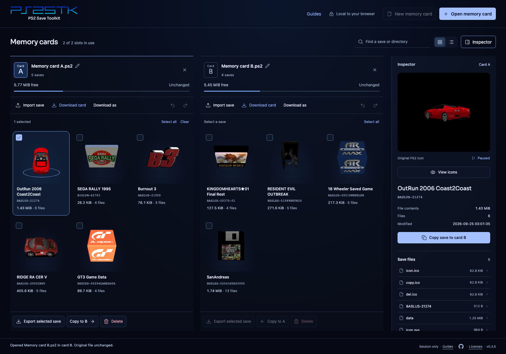
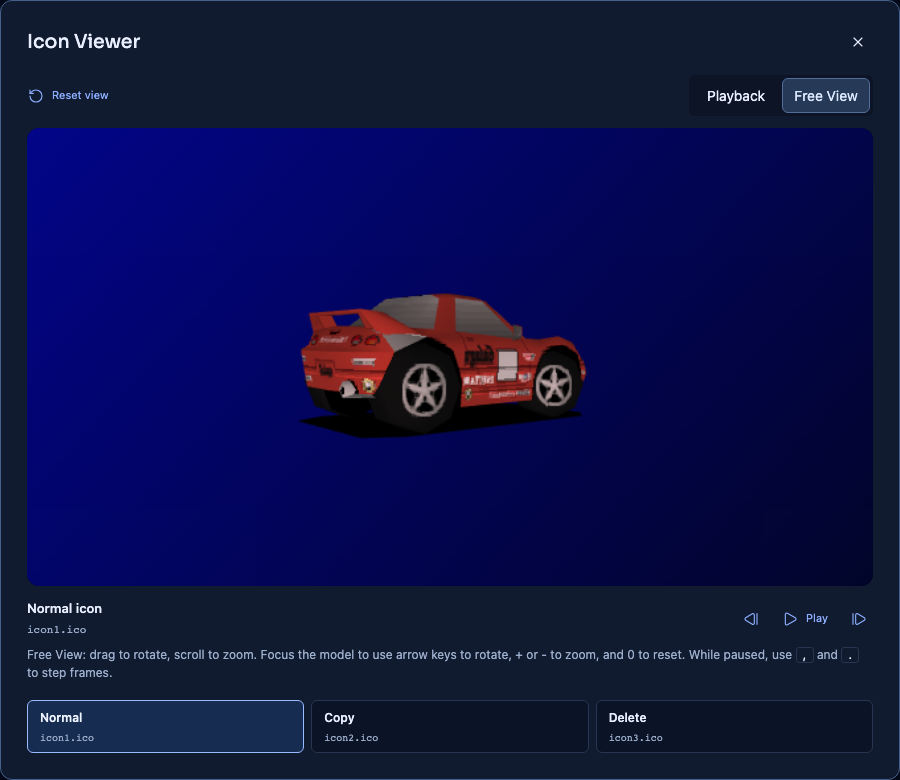
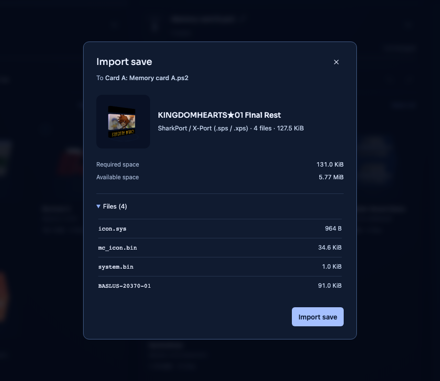

<p align="center">
  
</p>

<h1 align="center">PS2 Save Toolkit</h1>

<p align="center">
  Browse, copy, and manage your PlayStation 2 saves in your browser.<br>
  No installation. No accounts. No uploads.
</p>

<p align="center">
  <strong><a href="https://ps2stk.craigshaw.com">Open PS2STK</a></strong>
  · <a href="https://ps2stk.craigshaw.com/guides/">Read the guides</a>
</p>



## Your saves, at a glance

- **Two cards, side by side.** Open two memory card images and copy saves between them, or create an empty card.
- **Original 3D icons.** Recognise saves by their game artwork. Rotate, zoom, pause, and step through animated models.
- **Raw save export.** Download individual save files byte for byte, without package headers or wrappers, or dump a complete save to a folder. Ready for hex editing, comparing save data, and reverse engineering.
- **Control over every edit.** Copy or delete saves, inspect and replace individual files, and use per-card Undo and Redo.
- **Save formats in one place.** Import packages, including those inside ZIP and RAR archives. Review space and conflicts before importing.
- **Packages and complete cards.** Export a save package or download the complete edited memory card.

<table>
  <tr>
    <td width="50%"></td>
    <td width="50%"></td>
  </tr>
  <tr>
    <td align="center">Explore the original 3D save icons.</td>
    <td align="center">Review a save before it reaches your card.</td>
  </tr>
</table>

## Get started

1. **[Open PS2STK](https://ps2stk.craigshaw.com)** in a desktop browser. Open a memory card image, or create an empty card to start with a save package.
2. **Choose your saves.** Open a second card to copy between cards, or use **Import save** to add a package. Select a save to inspect, export, or delete it.
3. **Download your card** to keep your changes.

Your card data stays in your browser, and original input files stay unchanged.
**Download your results before closing or refreshing the page.** Cards and edits
are kept only for the current page session. Exporting a single save does not
save the rest of the card.

To download raw data, select a file under **Save files** in the inspector and
choose **Dump file**. For a complete raw save dump, choose **Export selected
save**, then **Raw files to folder** in Chrome or Edge.

Need a walkthrough? See [importing saves](https://ps2stk.craigshaw.com/guides/import-ps2-saves/),
[copying between cards](https://ps2stk.craigshaw.com/guides/copy-ps2-saves/),
or the [save format guide](https://ps2stk.craigshaw.com/guides/ps2-save-formats/).

## Supported formats

Open and download standard **8 MiB memory card images** as `.ps2`, `.mc2`, or
`.bin`, with or without ECC spare bytes. `.ps2` downloads include ECC; `.mc2`
and `.bin` downloads omit it.

| Save package | Import | Export |
| --- | :---: | :---: |
| PSU | Yes | Yes |
| MAX | Yes | Yes |
| SPS / XPS | Yes | No |
| CBS | Yes | No |
| PS2 PSV | Yes, with signature verification | Yes, signed |

ZIP and RAR archives can contain several packages; choose one save per import.
MAX and PSV exports ask you to acknowledge metadata loss. Packages support
saves without subfolders. For saves with subfolders, download the complete card
or use folder export.

Chrome and Edge support folder export when directory access is available.
Firefox and Safari support editing and file, package, and card downloads.
Game-load checks on PCSX2, PS2 through MemCard PRO2, and PS3 remain pending.
See [validation status](PRODUCT.md#release-validation) for the current limits.

## Run locally

Install **Node.js 24**, which includes npm. Then run:

```sh
git clone https://github.com/craigshaw/ps2stk.git
cd ps2stk
npm ci
npm run dev
```

Open the local URL printed in the terminal, usually `http://localhost:5173`.

### Build for production

```sh
npm run build
```

The built site is in `dist/`. It is a static site with no backend or runtime
secrets. To preview the build locally:

```sh
npm run preview
```

### Run checks

```sh
npm run check
npx playwright install chromium firefox webkit
npm run test:browser
```

`check` runs TypeScript checks, unit and CLI tests, and the production build.
The browser suite runs in Playwright Chromium, Firefox, and WebKit.
See [test fixtures](tests/fixtures/README.md) for independent format checks and
fixture sources.

### Command line

A CLI is included for local scripts and card operations:

```sh
npm run card -- inspect source.ps2
npm run card -- export-save source.ps2 SAVE-NAME exported.psu
```

Run `npm run card --` to see all commands. Output paths must be new files.

## Project

Built with React, TypeScript, Vite, and Three.js.
See [product scope](PRODUCT.md) and [third-party notices](THIRD_PARTY_NOTICES.md).
The screenshots show real game saves; the save files are not included.
